

  <h1>🏠 Nutmeg &amp; Ginger's Cottage</h1>

  

    A multiplayer fairytale game built around logic riddles.
  

<h2>📑 Table of Contents</h2>

<ul>
  <li><a href="#objective">Objective</a></li>
  <li><a href="#inspiration">Inspiration</a></li>
  <li><a href="#project-details">Project Details</a></li>
  <li><a href="#game">Game</a></li>
  <li><a href="#screenshots">Screenshots</a></li>
  <li><a href="#gifs">GIFs</a></li>
  <li><a href="#board-game-edition">Board Game Edition</a></li>
</ul>

<h2 id="objective">🎯 Objective</h2>

  This project creates a real-time fairytale game for
  2–8 players, inspired by the Shrek The Third scene
  where Pinocchio uses clever logic to avoid lying to
  Prince Charming. His replies bring propositional logic
  to life through playful riddles with ChatGPT. Players
  join with a room code and complete synchronized, timed
  rounds with shared scoring as their cottage builds
  or crumbles.

<h2 id="inspiration">🎬 Inspiration</h2>

<h3>Shrek The Third's Pinocchio Tries to Lie Scene</h3>

<table>
  <tr>
    <td>
      
    </td>
  </tr>
</table>

  <a href="https://youtu.be/2xhC2cbq7zA">
    Watch Video
  </a>

<h2 id="project-details">🛠️ Project Details</h2>

  <strong>Tools:</strong> ChatGPT

  <strong>Model:</strong> ChatGPT 6.1 Sol (2026)

  <strong>Estimated Token Usage:</strong> 68M+

  <strong>Format:</strong> Browser Game for PC and Mobile

<h2 id="game">🎮 Game</h2>

  <a href="https://nutmeg-ginger-cottage.airyant14.chatgpt.site">
    Play Game
  </a>

<h2 id="screenshots">📱 Screenshots</h2>

<h3>Game Menu Screen</h3>

<table>
  <tr>
    <td>
      <a href="https://github.com/redefiningvicky/Nutmeg-Ginger-Cottage/blob/main/Nutmeg_Ginger_Cottage_Screen/Nutmeg_Ginger_Cottage_Menu.png">
        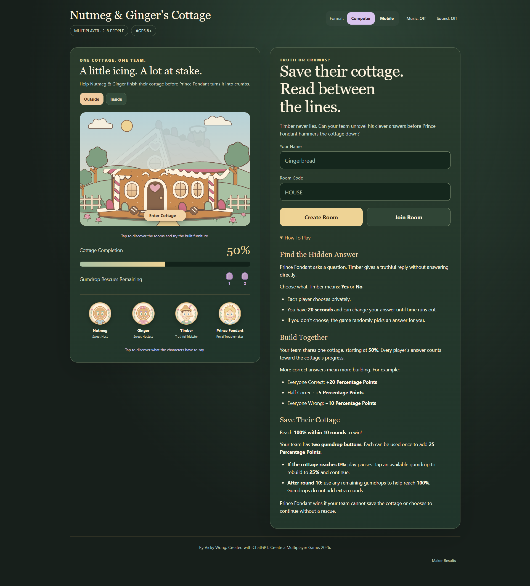
      </a>
    </td>
  </tr>
</table>

<h3>Victory Screen</h3>

<table>
  <tr>
    <td>
      <a href="https://github.com/redefiningvicky/Nutmeg-Ginger-Cottage/blob/main/Nutmeg_Ginger_Cottage_Screen/Nutmeg_Ginger_Cottage_Win.png">
        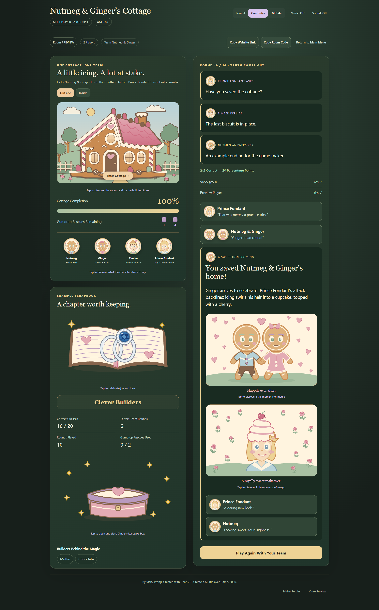
      </a>
    </td>
  </tr>
</table>

<h3>Defeat Screen</h3>

<table>
  <tr>
    <td>
      <a href="https://github.com/redefiningvicky/Nutmeg-Ginger-Cottage/blob/main/Nutmeg_Ginger_Cottage_Screen/Nutmeg_Ginger_Cottage_Lose.png">
        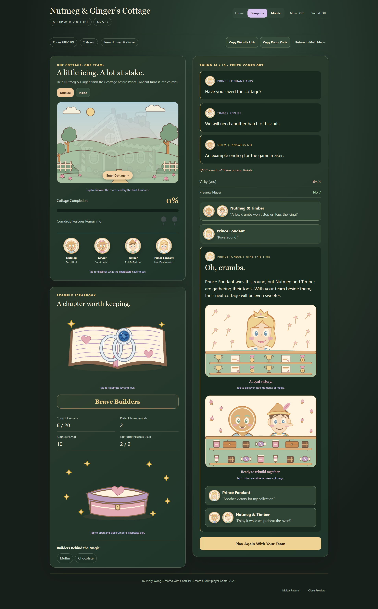
      </a>
    </td>
  </tr>
</table>

<h2 id="gifs">🖼️ GIFs</h2>

<h3>First Floor — Kitchen</h3>

<table>
  <tr>
    <td>
      <a href="https://github.com/redefiningvicky/Nutmeg-Ginger-Cottage/blob/main/Nutmeg_Ginger_Cottage_Design/first-floor-kitchen.gif">
        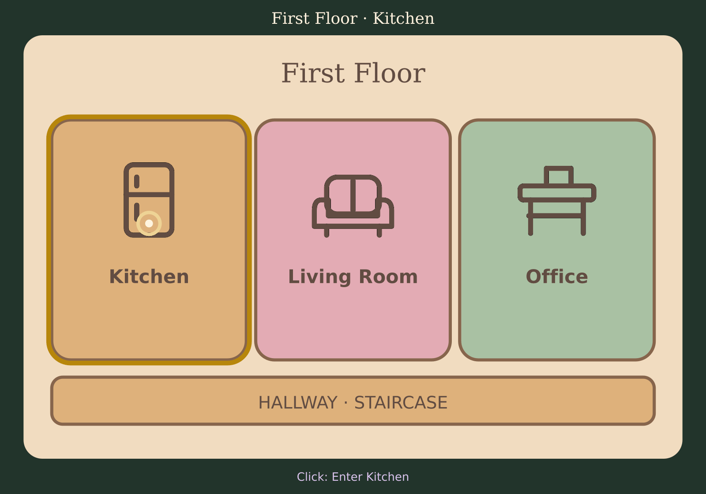
      </a>
    </td>
  </tr>
</table>

<h3>First Floor — Living Room</h3>

<table>
  <tr>
    <td>
      <a href="https://github.com/redefiningvicky/Nutmeg-Ginger-Cottage/blob/main/Nutmeg_Ginger_Cottage_Design/first-floor-living-room.gif">
        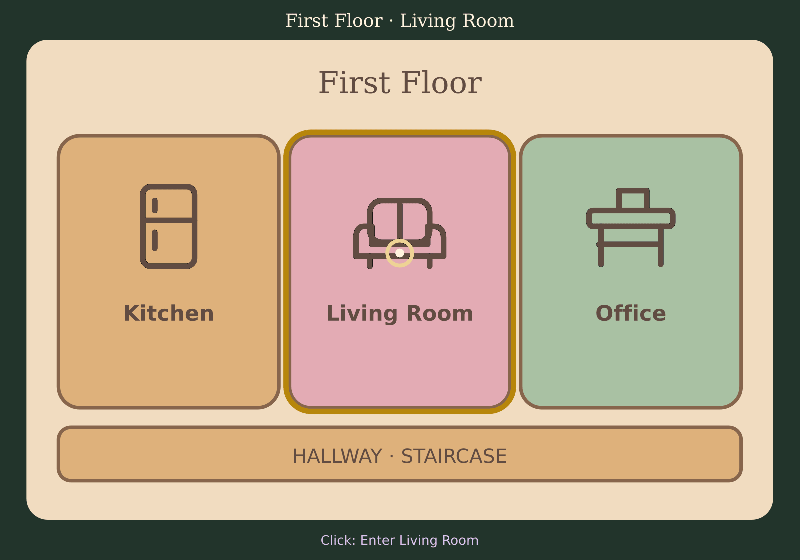
      </a>
    </td>
  </tr>
</table>

<h3>First Floor — Office</h3>

<table>
  <tr>
    <td>
      <a href="https://github.com/redefiningvicky/Nutmeg-Ginger-Cottage/blob/main/Nutmeg_Ginger_Cottage_Design/first-floor-office.gif">
        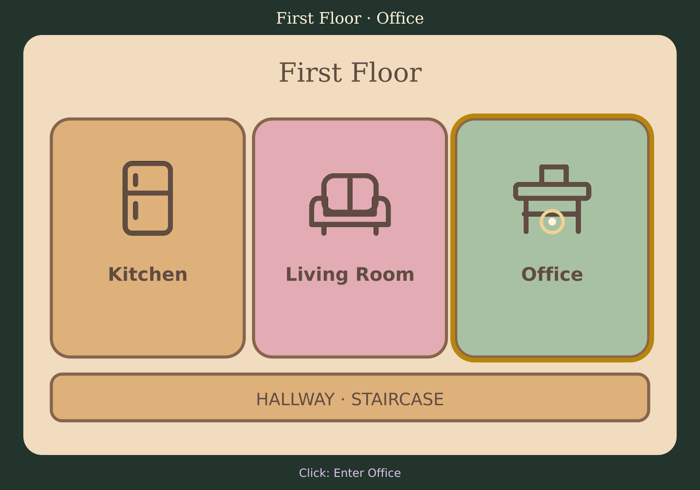
      </a>
    </td>
  </tr>
</table>

<h3>Second Floor — Bedroom</h3>

<table>
  <tr>
    <td>
      <a href="https://github.com/redefiningvicky/Nutmeg-Ginger-Cottage/blob/main/Nutmeg_Ginger_Cottage_Design/second-floor-bedroom.gif">
        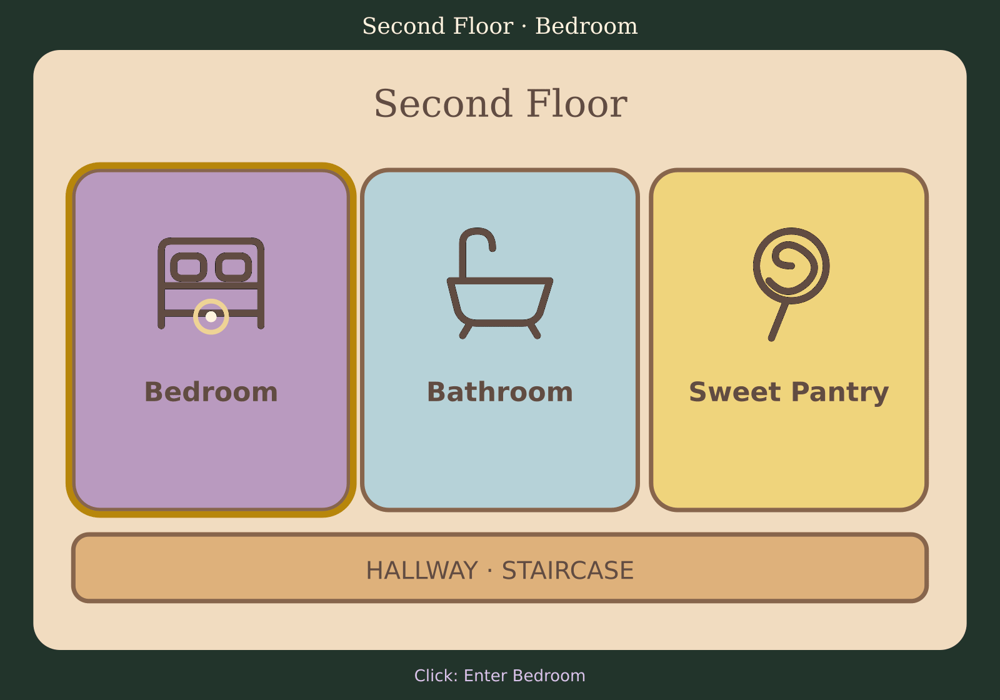
      </a>
    </td>
  </tr>
</table>

<h3>Second Floor — Bathroom</h3>

<table>
  <tr>
    <td>
      <a href="https://github.com/redefiningvicky/Nutmeg-Ginger-Cottage/blob/main/Nutmeg_Ginger_Cottage_Design/second-floor-bathroom.gif">
        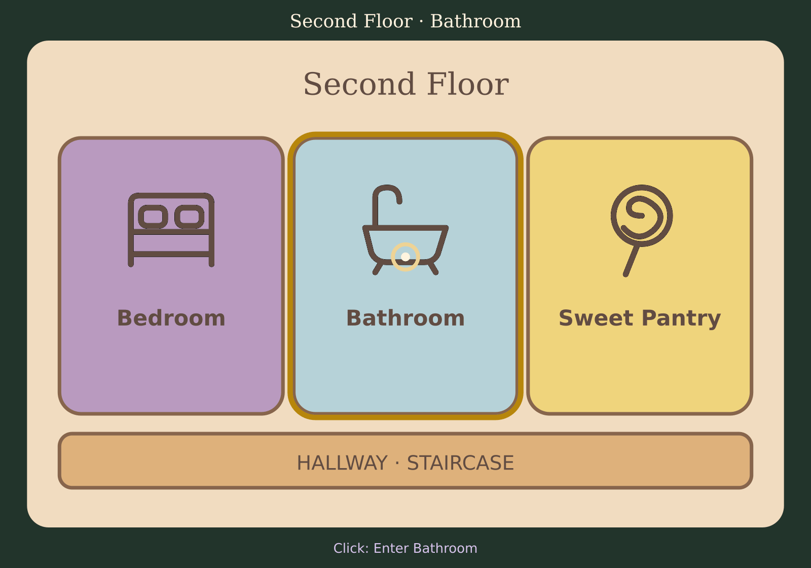
      </a>
    </td>
  </tr>
</table>

<h3>Second Floor — Sweet Pantry</h3>

<table>
  <tr>
    <td>
      <a href="https://github.com/redefiningvicky/Nutmeg-Ginger-Cottage/blob/main/Nutmeg_Ginger_Cottage_Design/second-floor-sweet-pantry.gif">
        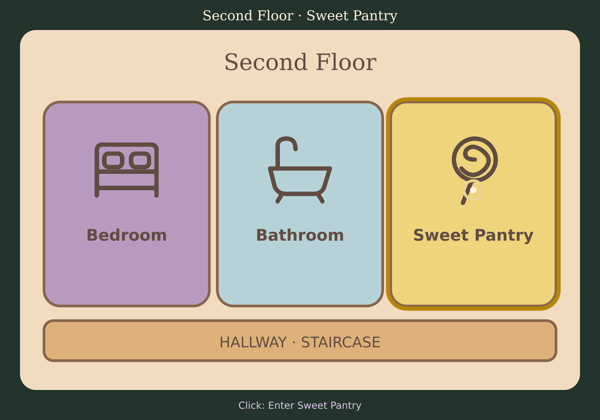
      </a>
    </td>
  </tr>
</table>

<h3>Happily Ever After</h3>

<table>
  <tr>
    <td>
      <a href="https://github.com/redefiningvicky/Nutmeg-Ginger-Cottage/blob/main/Nutmeg_Ginger_Cottage_Design/happily-ever-after.gif">
        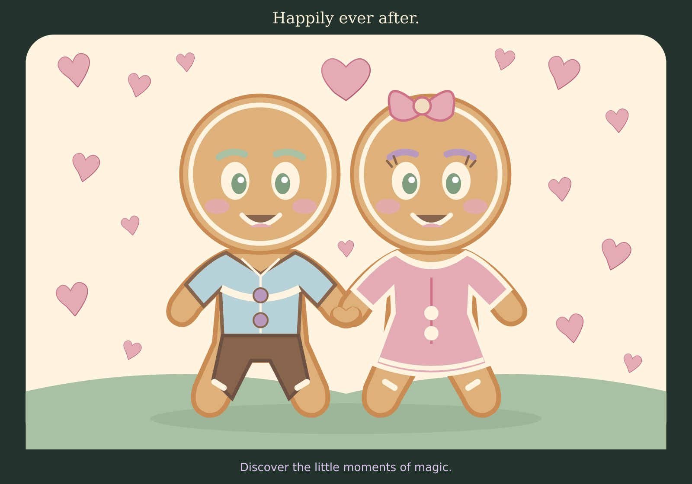
      </a>
    </td>
  </tr>
</table>

<h3>A Royally Sweet Makeover</h3>

<table>
  <tr>
    <td>
      <a href="https://github.com/redefiningvicky/Nutmeg-Ginger-Cottage/blob/main/Nutmeg_Ginger_Cottage_Design/a-royally-sweet-makeover.gif">
        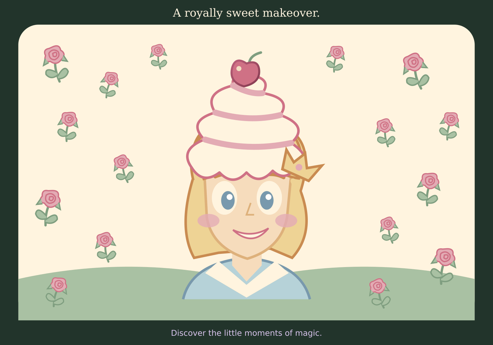
      </a>
    </td>
  </tr>
</table>

<h3>A Royal Victory</h3>

<table>
  <tr>
    <td>
      <a href="https://github.com/redefiningvicky/Nutmeg-Ginger-Cottage/blob/main/Nutmeg_Ginger_Cottage_Design/a-royal-victory.gif">
        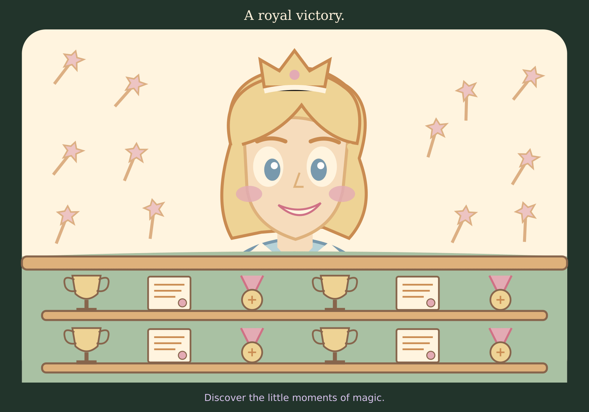
      </a>
    </td>
  </tr>
</table>

<h3>Ready to Rebuild Together</h3>

<table>
  <tr>
    <td>
      <a href="https://github.com/redefiningvicky/Nutmeg-Ginger-Cottage/blob/main/Nutmeg_Ginger_Cottage_Design/ready-to-rebuild-together.gif">
        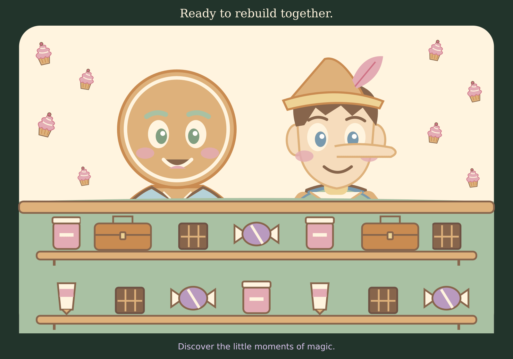
      </a>
    </td>
  </tr>
</table>

<h3>Storybook</h3>

<table>
  <tr>
    <td>
      <a href="https://github.com/redefiningvicky/Nutmeg-Ginger-Cottage/blob/main/Nutmeg_Ginger_Cottage_Design/storybook.gif">
        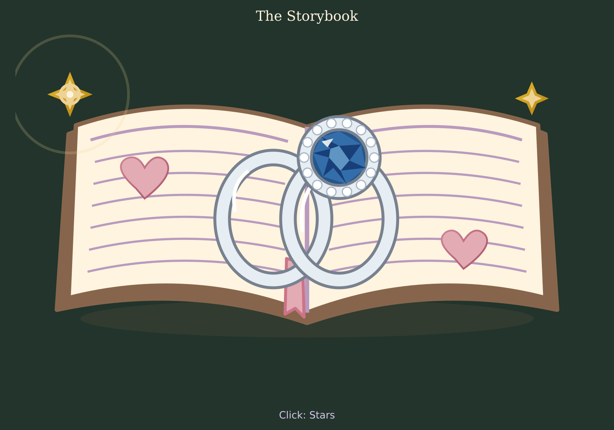
      </a>
    </td>
  </tr>
</table>

<h3>Keepsake</h3>

<table>
  <tr>
    <td>
      <a href="https://github.com/redefiningvicky/Nutmeg-Ginger-Cottage/blob/main/Nutmeg_Ginger_Cottage_Design/keepsake.gif">
        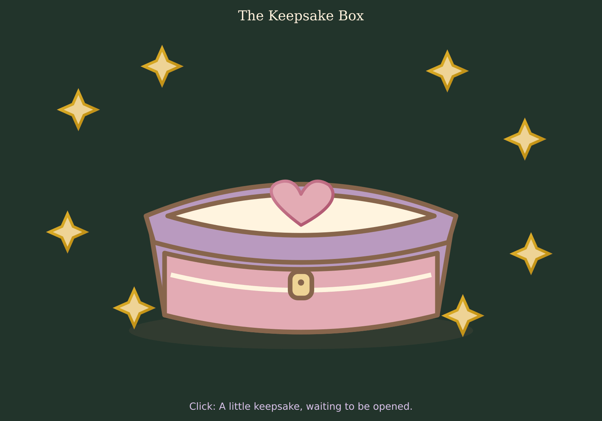
      </a>
    </td>
  </tr>
</table>

<h2 id="board-game-edition">🎲 Board Game Edition</h2>

  The digital adventure also inspired a physical board game concept,
  bringing the same riddles, teamwork, and sweet surprises to the table.
  The board game edition remains a separate project.

  <a href="https://github.com/redefiningvicky/Nutmeg-Ginger-Cottage-Board-Game">View Board Game Project</a>

  

    <a href="https://github.com/redefiningvicky/Vibe-Coding-Projects">Back to Vibe Coding Projects</a>
    &nbsp; • &nbsp;
    <a href="https://github.com/redefiningvicky/redefiningvicky">Back to Portfolio</a>
  

